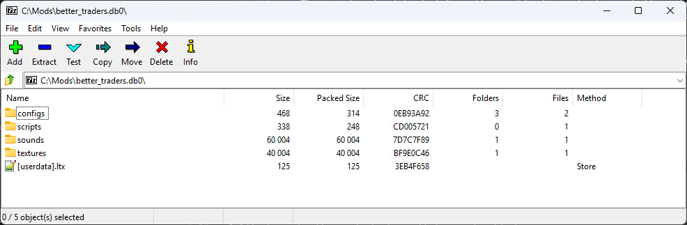
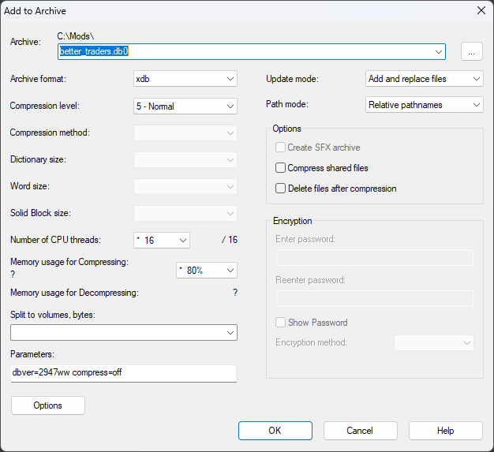
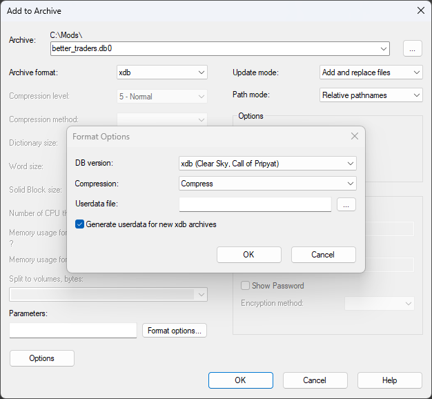

<h1 align="center">Xray DB 7z Plugin</h1>

  Open, edit and pack S.T.A.L.K.E.R. game archives in 7-Zip.

  
  
  
  

  

S.T.A.L.K.E.R. keeps its game data in `.db` archives. With this plugin, 7-Zip opens them like
any zip file: browse and extract, drag files in, rename or delete them, or edit a config or
script and save it straight back. The archive is updated in place, with no unpacking and
repacking.

## 🎮 Supported games

| Game | Archive version |
|---|---|
| Clear Sky, Call of Pripyat, Anomaly and most mods | `xdb` |
| Shadow of Chernobyl (worldwide), Lost Alpha | `2947ww` |
| Shadow of Chernobyl (Russian) | `2947ru` |
| Early builds 1114–2945 | `11xx`, `2215`, `2945` |

The version is detected from the archive itself, so renamed archives open too. `xdb` and
`2947ww` archives the plugin writes are tested by loading them in eight games, from Shadow of
Chernobyl to Anomaly. The other versions are checked against reference tools, not yet in a game.

## 📦 Installation

1. Download the latest zip from [Releases](https://github.com/Tosox/xray-db-7z-plugin/releases).
2. Copy `XDB_x64.dll` into 7-Zip's `Formats` folder, for example `C:\Program Files\7-Zip\Formats`.
   Create the folder if it isn't there. Use `XDB_x86.dll` for 32-bit 7-Zip.
3. Open any `.db*` or `.xdb*` archive, for example with right-click → **7-Zip** → **Open archive**.

Works with 7-Zip 19.00 and later.

## 🛠️ Packing a mod

Select the **contents** of your mod's `gamedata` folder, not the folder itself, then
**Add to archive...** and choose the **xdb** format. The archive is compressed like the game's
own.

For another game version or no compression, type options into **Parameters**, for example
`dbver=2947ww compress=off`. The [usage guide](docs/usage.md#parameters) lists them all.

> [!TIP]
> With [Tosox/7zip](https://github.com/Tosox/7zip), a 7-Zip with one addition for plugins,
> **Format options...** shows these options as dropdowns instead. It installs over your 7-Zip
> like the official setup.

| Stock 7-Zip | Tosox/7zip |
|:-:|:-:|
|  |  |
| Options are typed into *Parameters*. | **Format options...** offers them as dropdowns. |

## 📚 Documentation

- [Usage](docs/usage.md): opening and editing, creating and converting archives, parameters, the fork, userdata, limitations
- [Archive format](docs/db-format.md): how the six versions are laid out on disk
- [Building and testing](docs/building.md): building the DLLs, the unit tests and the tests against installed games
- [Changelog](CHANGELOG.md)

## 🙏 Acknowledgements

- **bardak (setback)** for [xray_re-tools](https://github.com/abramcumner/xray_re-tools): the format
  knowledge, the header cipher and the LZHUF port come from his work, and the tests check the
  plugin against it. Thanks to abramcumner for keeping the mirror alive.
- **Igor Pavlov** for [7-Zip](https://www.7-zip.org) and its plugin interface.
- **Jack Andersen** for [lzokay](https://github.com/AxioDL/lzokay), the LZO1X compressor.
- **Haruyasu Yoshizaki, Haruhiko Okumura and Kenji Rikitake** for LZHUF.
- **GSC Game World** for S.T.A.L.K.E.R. and the X-Ray engine.

## 📄 License

* Plugin-specific code: GNU GPL v3 or later (see `LICENSE`)
* Third-party code keeps its own licenses (see `NOTICE`)

---

  <em>🤖 Built with substantial help from Claude Code · verified by the <a href="tests">unit tests</a> and against real game archives</em>

