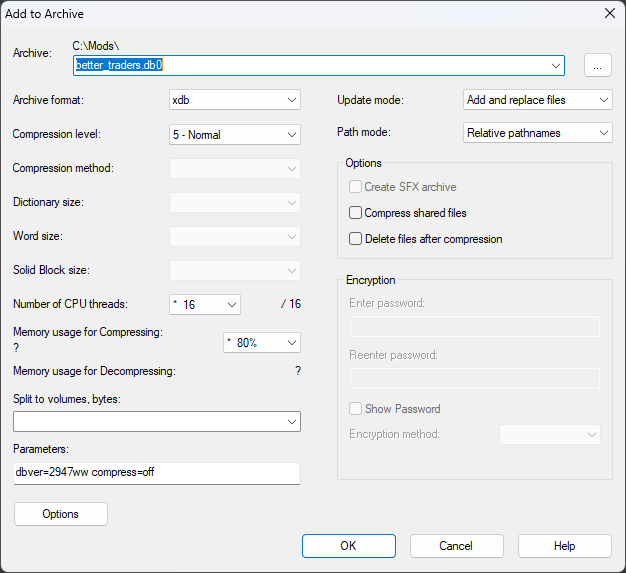
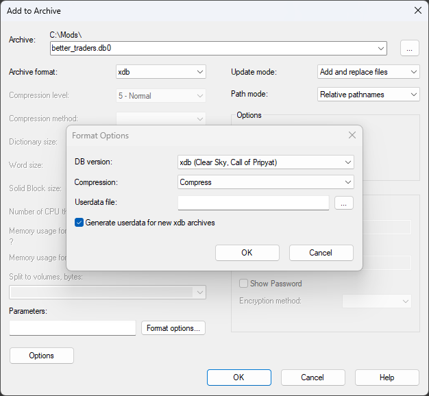
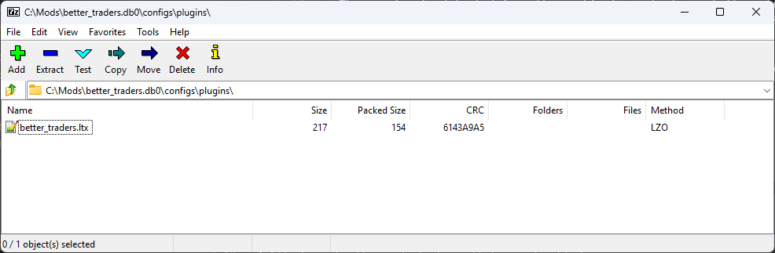

# Using the plugin

- [Installation](#installation)
- [Opening and editing archives](#opening-and-editing-archives)
- [Creating archives](#creating-archives)
- [Parameters](#parameters)
- [The Tosox/7zip fork](#the-tosox7zip-fork)
- [Userdata](#userdata)
- [What 7-Zip shows](#what-7-zip-shows)
- [Limitations](#limitations)

## Installation

1. Download the latest release zip from [Releases](https://github.com/Tosox/xray-db-7z-plugin/releases).
2. Pick the DLL that matches your 7‑Zip:
   - `XDB_x64.dll` for 64‑bit 7‑Zip (most installs)
   - `XDB_x86.dll` only if you run 32‑bit 7‑Zip
3. Copy it into 7‑Zip's `Formats` folder, for example `C:\Program Files\7-Zip\Formats`. Create the folder if it isn't there.

The plugin works with 7‑Zip 19.00 and later. For the **Format options...** dialog, install the
[Tosox/7zip](https://github.com/Tosox/7zip) fork instead of stock 7-Zip; see [below](#the-tosox7zip-fork).

## Opening and editing archives

Open a `.db*` or `.xdb*` archive in 7-Zip like any other archive. The version is detected from the
archive's contents, not its extension, so a renamed archive opens just as well.

Inside the archive you can:

- extract files and folders, or test the archive;
- edit a text file such as a config or script with **File → Edit** (F4). It opens in the editor
  set in *Tools → Options → Editor*, which is Notepad unless you change it. After you save it,
  7-Zip offers to update it in the archive;
- add files by dragging them in, and replace, rename or delete files and folders.

Each change rewrites the archive in the same version and keeps the other files as they are.

Large archives show progress, can be cancelled and use little memory.
A damaged archive is reported as an error instead of crashing 7-Zip.

## Creating archives

Select the files to pack, then **Add to archive...** in 7-Zip or the Explorer context menu, and
choose the **xdb** format. To pack a mod, add the *contents* of its `gamedata` folder, not the
folder itself, as the game mounts the archive at `gamedata`.

New archives are `xdb` archives, compressed, with a default userdata block. The
[parameters](#parameters) change that.

From the command line:

```pwsh
7z a mymod.db0 .\gamedata\* -txdb
7z a mymod.db0 .\gamedata\* -txdb -mdbver=2947ww -mcompress=off
7z u old_build.db -txdb -mdbver=xdb -x!*   # converts an archive to xdb
```

The `-x!*` matters: without file names, 7-Zip's `u` adds everything in the current folder.

## Parameters

Type them into the **Parameters** field of the *Add to Archive* dialog, for example
`compress=off xdb_ud="D:\Mods\my mod\userdata.ltx"`, or pass them with `-m` on the command line.
With the [fork](#the-tosox7zip-fork), the **Format options...** button shows them as regular controls.

| Parameter | Values | Default | Meaning |
|-----------|--------|---------|---------|
| `dbver` | `auto`, `xdb`, `2947ww`, `2947ru`, `2945`, `2215`, `11xx` | `auto` | Version to write. `auto` keeps the version of an existing archive and uses `xdb` for new ones. Reading always detects the version. |
| `compress` | `auto`, `on`, `off` | `auto` | Compress new files. `auto` follows the archive being updated (compress if most of its files are compressed); new archives are compressed. A file that doesn't get smaller is stored either way. |
| `xdb_ud` | path to a file | – | Use the file's contents as the userdata block (`xdb` only). Quote paths with spaces: `xdb_ud="D:\My Mods\userdata.ltx"`. |
| `gen_xdb_ud` | `on`, `off` | `on` | Give new `xdb` archives (and archives converted to `xdb`) a default `[header]` userdata block. |
| `keepdups` | `on`, `off` | `off` | Keep all entries of damaged archives that list the same path more than once. By default only the last one is kept. |

Versions and the games that use them (details in [db-format.md](db-format.md)):

| `dbver` | Games |
|---------|-------|
| `xdb` | Clear Sky, Call of Pripyat, and most mods |
| `2947ww` | Shadow of Chernobyl (worldwide), build 3120, Lost Alpha |
| `2947ru` | Shadow of Chernobyl (Russian) |
| `2945` | builds 2571–2945 |
| `2215` | builds 1512–2232 |
| `11xx` | builds 1114, 1154–1472 |

## The Tosox/7zip fork

[Tosox/7zip](https://github.com/Tosox/7zip) is 7-Zip with one addition for format plugins like
this one: a plugin can describe its options, and the *Add to Archive* dialog shows them as
controls. Everything else is 7-Zip as you know it; it installs over an existing 7-Zip.

| Stock 7-Zip | Tosox/7zip |
|:-:|:-:|
|  |  |
| Options are typed into *Parameters* from memory. | **Format options...** shows them as dropdowns, with the game names. |

With the fork:

- **Format options...** shows the game version and compression as dropdowns and the userdata file
  with a browse button.
- For a new archive it offers what the archive will actually get (`xdb`, Compress). For an
  existing one it offers **Keep existing**, which leaves the archive's version and compression
  as they are.
- Settings the plugin doesn't use (compression level, CPU threads, memory) are greyed out, and so
  is *Split to volumes*, as the games can't read split archives.
- Paths with spaces work in *Parameters* when quoted. Stock 7-Zip splits them at the space.

The plugin works the same in both; the fork only makes the dialog easier.

## Userdata

`xdb` archives can carry a userdata block, usually an LTX `[header]` section that describes a mod.
It appears as `[userdata].ltx` at the top of the archive:

- edit it like any other file (**File → Edit**, F4);
- replace it by adding or renaming a file to that name;
- rename it to keep its contents as an ordinary file;
- delete it to remove the block.

An `xdb_ud` parameter always takes precedence.

## What 7-Zip shows



- Archive properties (the **Info** button): **Userdata** (the userdata text) and **DB-Format** (the detected version)
- File columns: **Method** is `LZO`, `LZHUF` or `Store`; **CRC** only for versions that store one (`2945` and later)

## Limitations

- Writing to standard output (`-so`) is not supported: the archive's size fields are filled in after the files are written.
- Archives are limited to 4 GiB by the format.
- Files over 256 MiB are always stored uncompressed, as files are compressed in memory.
- File names must be representable in the Windows Cyrillic code page (CP1251), like the game expects.
  Other characters, including accented Latin letters such as `ü` or `é`, are refused.
- A file can't share its name with another file or a folder; a rename or copy that would cause this is refused.
